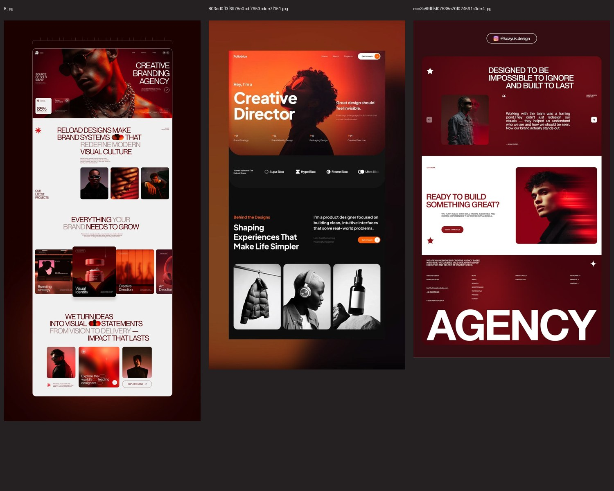

# GATE13 — electronic press kit

Подготовка сайта-презентации дуэта GATE13 для букинг-агентств и промоутеров. Сайт будет **только на английском**. Текущий этап — техническое задание и дизайн-система, без приложения и деплоя.

| Документ | Содержание |
| --- | --- |
| [Техническое задание](TECHNICAL_SPEC.md) | Сценарии, все блоки страницы, поведение, медиа, технические требования и приёмка |
| [Дизайн-система](DESIGN.md) | Предлагаемое направление Red Aperture, палитра, типографика, сетка, ритм, компоненты, motion и mobile |
| [Аудит контента](docs/CONTENT_AUDIT.md) | 17 фото, 17 видео, 6 страниц старого профиля, 14 позиций афиш/обложек и статусы фактов |
| [Реестр файлов](docs/media-inventory.json) | Пути к оригиналам, размеры, SHA-256 и video metadata |
| [Компоненты и источники](docs/COMPONENT_RESEARCH.md) | Обязательная Tilted Grid и решения по остальным предложениям 21st.dev |
| [Critique и проверка](docs/REVIEW.md) | Проверка каждого блока, внесённые исправления и пределы текущей верификации |
| [Контекст продукта](PRODUCT.md) | Подтверждённые факты и открытые решения |

## Предлагаемое направление

Реальные портреты обоих артистов, угловатый знак G13, световой проём фотографии G6, чередование ink/wine/paper-глав. Крупная типографика и обязательная криволинейная фотолента из [Tilted Grid Hero](https://21st.dev/@ruixen.ui/components/tilted-grid-hero). Это проектное предложение для обсуждения, не согласованный макет и не готовый сайт.

## Материалы и рабочая папка

Локальный корень: `C:\Users\G13\Desktop\CHATGPT\Gate13`. Исходники: `drive-download-20261102T083738Z-1-001/`; стилевые JPG: `Референсы/`.

Оригиналы суммарно занимают около 931 MB (десятичные единицы), включая примерно 847 MB видео. Они сохранены локально и исключены из Git: два отдельных видео больше [стандартного 100 MiB лимита GitHub](https://docs.github.com/en/repositories/working-with-files/managing-large-files/about-large-files-on-github). В репозитории — документы, JSON-реестр и компактные контактные листы для просмотра; это не public press bundle и не замена masters. Для работы с другого компьютера понадобятся исходная папка материалов и отдельный медиа-хостинг на этапе реализации.

[Фото](docs/evidence/photos-contact-sheet.jpg) · [Видео](docs/evidence/videos-contact-sheet.jpg) · [Био из старого PDF](docs/evidence/profile-bio.png) · [Архивный коллаж](docs/evidence/profile-archive.png).

## Следующий этап

Утвердить направление и стек, затем перейти к макету/вёрстке. До публичного запуска необходим подтверждённый booking-контакт; расширенная биография, релизы, исторические даты и состав скачиваемых материалов требуют фактического подтверждения. Подробности и безопасные fallback-сценарии записаны в ТЗ.
